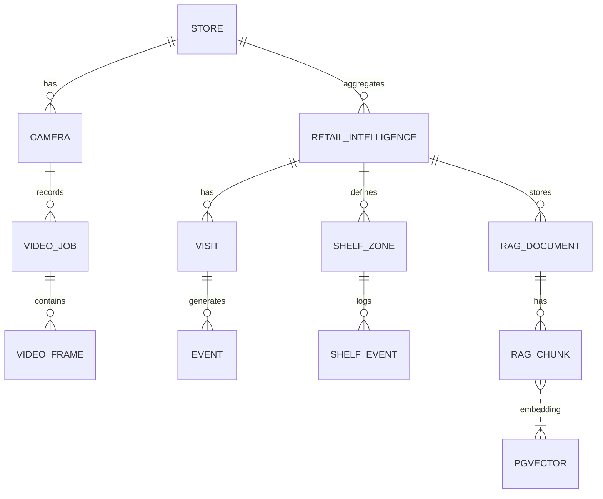
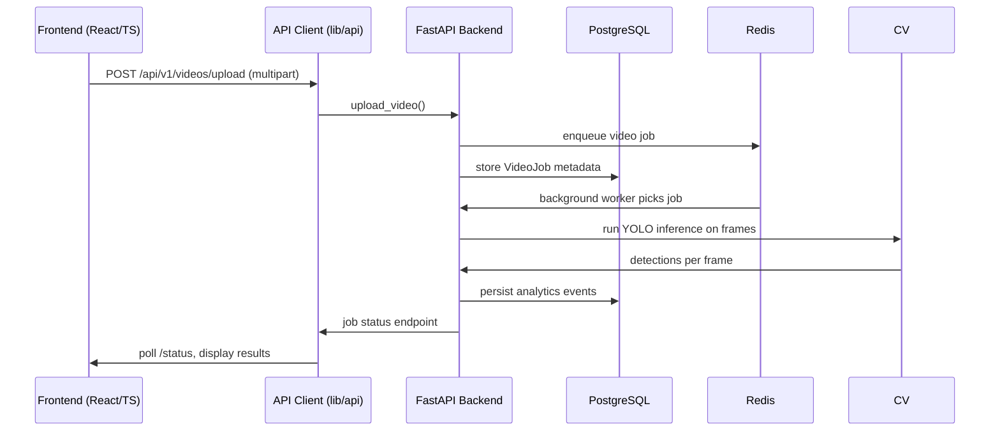
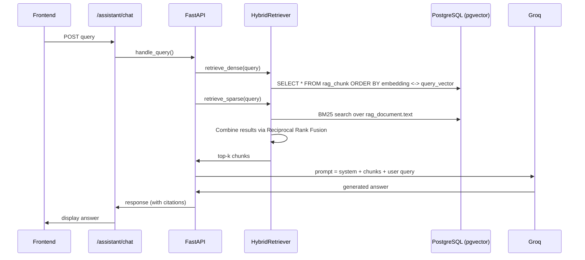

# RetailIQ – Architecture Diagrams

## 1. High‑Level System Diagram
```mermaid
flowchart TD
    subgraph FE[Frontend (Next.js)]
        UI[UI Pages & Components]
        APIClient[API Client (lib/api)]
    end
    subgraph BE[Backend (FastAPI)]
        Router[API Routers]
        Service[Service Layer]
        DB[PostgreSQL + pgvector]
        Redis[Redis (job queue & cache)]
        CV[YOLO‑11n (torch)]
        RAG[Hybrid Retrieval (dense + BM25)]
        LLM[Groq LLM]
    end
    UI -->|HTTP/JSON| APIClient -->|calls| Router
    Router --> Service
    Service --> DB
    Service --> Redis
    Service --> CV
    Service --> RAG --> LLM
    DB -->|stores| VideoJob[video_job]
    DB -->|stores| RetailInt[retail_intelligence]
    DB -->|stores| RagDoc[rag_document]
    Redis -->|queues| VideoJob
```

## 2. Backend Component Diagram
```mermaid
graph LR
    A[FastAPI] --> B[API Routers]
    B --> C[Services]
    C --> D[CV Service]
    C --> E[Video Service]
    C --> F[Shelf Service]
    C --> G[Identity Service]
    C --> H[Analytics Service]
    C --> I[RAG Service]
    D --> J[YOLO‑11n Model (torch)]
    E --> K[Redis Job Queue]
    I --> L[pgvector DB (embeddings)]
    I --> M[BM25 Engine (in‑memory)]
    I --> N[Groq LLM]
    H --> O[Event & Visit DB tables]
```

## 3. Database & Persistence Diagram


## 4. Frontend ↔ Backend Communication Diagram


## 5. Computer‑Vision Inference Pipeline (YOLO‑11n)
```mermaid
flowchart TD
    A[Video Upload] --> B[Save to /data/uploads]
    B --> C[Create VideoJob record]
    C --> D[Background worker reads job]
    D --> E[Extract frames (OpenCV)]
    E --> F[Pre‑process (resize, normalize)]
    F --> G[YOLO‑11n model inference]
    G --> H[Filter by confidence ≥ 0.3]
    H --> I[Optional tracking (centroid tracker)]
    I --> J[Zone & Shelf checks]
    J --> K[Persist detections & analytics]
    K --> L[Update VideoJob status]
``` 

## 6. RAG Retrieval & Generation Pipeline


## 7. CI/CD Workflow Diagram
```mermaid
flowchart TD
    subgraph PR[Pull Request]
        Lint[Lint (flake8, ESLint)]
        Unit[Backend Unit Tests]
        FrontTest[Frontend Playwright Tests]
        Build[Docker Build]
        Sec[Security Scan (trivy)]
    end
    PR --> Lint --> Unit --> FrontTest --> Build --> Sec
    Sec -->|pass| Deploy[No auto‑deploy (manual step)]
```

## 8. YOLO‑11n MLOps Lifecycle
```mermaid
flowchart LR
    DS[Dataset Validation] --> TR[Training (mlops/training)]
    TR --> EV[Evaluation (mlops/evaluation)]
    EV --> MET[Metrics: mAP50, mAP50‑95, latency]
    MET --> REG[Model Registry (mlops/registry)]
    REG --> GATE[Promotion Gate (thresholds)]
    GATE --> PROD[Production Model (weights/yolo11n.pt)]
    PROD --> INF[Inference Service (cv_service)]
    INF --> MON[Monitoring (mlops/monitoring)]
```

---
*All diagrams reference files that exist in the repository (e.g., `mlops/training/`, `app/services/cv_service.py`).*